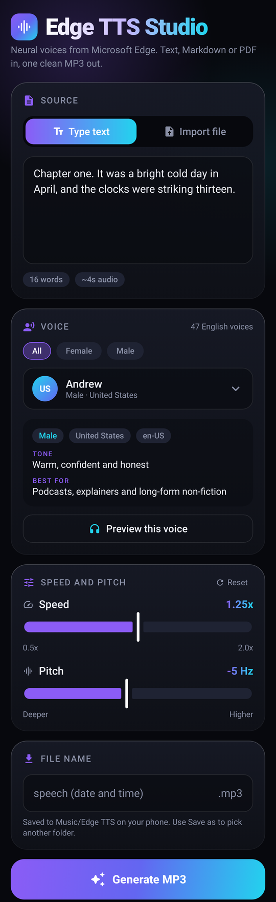

# Edge TTS Studio

Android app that turns text, Markdown and PDF files into MP3s using Microsoft Edge's neural "Read aloud" voices. Free, no API key, no account.



## Features

- **Input:** type or paste text, or import `.txt`, `.md` or `.pdf`. You can also share text or files into the app from other apps.
- **Clean up for listening** (on by default): strips Markdown, backslashes, underscores, emoji, decorative symbols, runs like `!!!!` or `=====`, code blocks, HTML, citation markers like `[12]` and page numbers. URLs are read as just the site name ("example.org"). It also adds full stops after headings, list items, titles and paragraph ends so the voice pauses where a person would. "Show what will be read" displays the exact text before you generate.
- **47 English voices** in a dropdown. You can filter by gender, and each voice shows its gender, country, tone and best use. **Preview** plays a short sample with your current settings.
- **Speed** slider from 0.5x to 2.0x and **pitch** slider from -50 Hz to +50 Hz. Both settings are remembered between sessions.
- **Long documents** are split into chunks and synthesized four at a time, with automatic retries. The parts are then stitched back into a single MP3 with ID3 title and artist tags.
- **Saving:** each MP3 is copied to `Music/Edge TTS` on the phone automatically (Android 10+, no storage permission needed). **Save as** lets you pick any other folder, and **Share** sends the file to other apps. A built-in library lets you play, re-share or delete past files.

## Install

Every push runs the GitHub Action **Build APK**. Open the latest run under **Actions**, download the `edge-tts-studio-apk` artifact, unzip it and install `app-release.apk` on your phone. You need to allow installs from unknown sources.

The release APK is signed with the debug key so it installs without extra setup. Use your own keystore before publishing it anywhere.

To build locally (JDK 17 and the Android SDK are required):

```bash
./gradlew assembleRelease
# -> app/build/outputs/apk/release/app-release.apk
```

## How it works

| Step | File |
| --- | --- |
| Extract text: PDFBox for PDF, commonmark for Markdown (strips links, code blocks and HTML), with PDF line-break reflow | `io/DocumentReader.kt`, `io/MarkdownToSpeech.kt` |
| Clean text for speech (runs on every source when the toggle is on) | `tts/SpeechCleaner.kt` |
| Chunk on paragraph, then sentence, then clause, then word boundaries, measured in XML-escaped bytes (2 KB per chunk) | `tts/TextChunker.kt` |
| Open a websocket to `speech.platform.bing.com`, send SSML with prosody, collect the MP3 frames | `tts/EdgeTtsClient.kt` |
| Generate the `Sec-MS-GEC` v2 token the service requires | `tts/SecMsGec.kt` |
| Run chunks in parallel with retries, write each part to disk, concatenate them, add an ID3 tag | `tts/SynthesisEngine.kt` |

Edge returns headerless constant-bitrate MP3 (24 kHz, 48 kbps, mono), so joining the parts byte for byte gives a valid file with the correct duration.

## Caveats

- This uses the same unofficial endpoint as Edge's Read Aloud feature. Microsoft changes the auth token scheme from time to time. The v1 token stopped working in 2026, and this app implements v2, ported from [rany2/edge-tts](https://github.com/rany2/edge-tts) 7.3.1. If generation starts failing with 403 errors, update `SecMsGec.kt` and `EdgeTtsClient.CHROMIUM_FULL_VERSION` to match the latest edge-tts release.
- Edge streams audio at roughly real-time pace for each connection. With four parallel connections, an hour of audio takes about 15 to 25 minutes. Keep the app in the foreground; the screen stays on while a job runs.
- Scanned PDFs (images with no text layer) need OCR first.

## Tests

```bash
./gradlew testDebugUnitTest                     # token vectors, chunker, speech cleanup, Markdown/PDF cleanup
EDGE_TTS_LIVE=1 ./gradlew testDebugUnitTest     # also hits the live service: all 47 voices + a multi-chunk stitch
```
